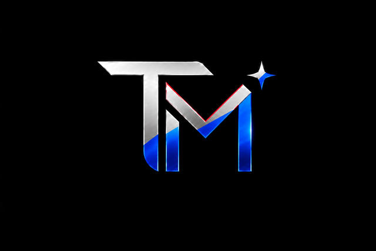

<p align="center">
  
</p>

<h1 align="center">TypeMind Spark</h1>

<p align="center">
  <b>Beyond What You Type. Your thoughts. Your AI. Your personal intelligence layer.</b>
</p>

<p align="center">
  <a href="https://tmspark.vercel.app"></a>
  
  
</p>

---

## 📖 Overview

**TypeMind Spark** is an AI-powered keyboard concept and intelligent communication ecosystem designed to make everyday digital writing adaptive, context-aware, and deeply personalized.

Rather than operating as a conventional static keyboard, TypeMind Spark is conceived as an **on-device personal intelligence layer** that interprets active application context, anticipates drafting thoughts, refines messages into distinct voices, and enables frictionless cross-app productivity without disrupting the user's flow.

🌐 **Interactive Product Showcase:** [tmspark.vercel.app](https://tmspark.vercel.app)

---

## 🚀 The Vision

Standard keyboards facilitate typing characters. **TypeMind Spark is designed to facilitate ideas.**

* **Ambient Context:** Seamlessly adapts suggestions, tone, and formatting depending on whether you are writing an email, a messaging chat, or a professional post.
* **On-Device Intelligence:** Anchors personal style, custom vocabulary, and memory on-device to uphold user privacy.
* **Integrated Workflow:** Brings AI drafting, multi-tone rewriting, and quick productivity triggers directly into the keyboard interface.

---

## ⚡ Core Capabilities

The product vision centers on eight defined capabilities, presented through dedicated video showcases and interactive concept walkthroughs:

| # | Capability | Focus & Role |
|---|---|---|
| **1** | **Live Context Detection (LCD)** | Identifies the active app environment to adjust suggestions and tone dynamically. |
| **2** | **Thought Completion (TC)** | Anticipates sentence direction and offers multi-word conceptual completions. |
| **3** | **Help Me Rewrite (HMR)** | Instantly transforms drafts into professional, concise, expressive, or casual tones. |
| **4** | **Personal AI Memory (PAM)** | Retains preferred phrases, recurring terminology, and personal writing habits locally. |
| **5** | **Personal AI Studio (PAS)** | Facilitates structured drafting and multi-paragraph composition from within the keyboard. |
| **6** | **Cross-App AI Actions (CAA)** | Creates reminders, calendar entries, and quick notes directly from typed text. |
| **7** | **Clone AI Agent (CAA)** | Aligns draft outputs and message reviews with the user's authentic personal voice. |
| **8** | **AI Generator Protector (AGP)** | Distinguishes synthetic drafts from original thought and guards against robotic phrasing. |

---

## 🏛️ Ecosystem Architecture

TypeMind Spark is engineered as part of the broader **Labs Spark** ecosystem:

```
┌─────────────────────────────────────────────────────────────────┐
│                           LABS SPARK                            │
│           Parent Research, Concept & Systems Platform           │
└───────────────────────────────┬─────────────────────────────────┘
                                │
        ┌───────────────────────┴───────────────────────┐
        ▼                                               ▼
┌───────────────────────────────┐       ┌───────────────────────────────┐
│        CLUSTER STUDIO         │       │        TYPEMIND SPARK         │
│  Creative suite & agent space │       │  On-device intelligence layer │
└───────────────────────────────┘       └───────────────┬───────────────┘
                                                        │
                                                        ▼
                                        ┌───────────────────────────────┐
                                        │           SPARK AI            │
                                        │  Dual-Engine Inference Model  │
                                        ├───────────────┬───────────────┤
                                        │     AURA      │     PRISM     │
                                        │ Fast everyday │ Deep intent   │
                                        │  completions  │   synthesis   │
                                        └───────────────┴───────────────┘
```

* **Labs Spark:** The overarching research initiative guiding next-generation human-computer interaction models.
* **Cluster Studio:** A planned unified environment for creative tooling and specialized agent workflows.
* **TypeMind Spark:** The user-facing interaction layer bringing intelligent assistance into daily input.
* **Spark AI Dual Engines:**
  * **🟣 AURA (Adaptive User Response Architecture):** Lightweight, ultra-responsive engine dedicated to real-time autocomplete, punctuation, and instantaneous grammar polish.
  * **🔵 PRISM (Personal Reasoning Intent Synthesis Model):** Higher-capacity contextual engine handling multi-paragraph synthesis, tone mapping, and complex drafting.

---

## 🛠️ Showcase Technology Stack

The interactive product web experience is built with modern web technologies:

* **Markup & Structure:** Semantic HTML5 with accessibility attributes and ARIA roles
* **Styling & Layout:** Tailwind CSS utility framework and custom design tokens (`css/style.css`)
* **Motion & Physics:** GSAP 3.12 (GreenSock) and ScrollTrigger with GPU-accelerated transforms
* **Smooth Scrolling:** Lenis 1.1 momentum scroll synchronization
* **Background Graphics:** 3D interactive HTML5 Canvas fluid ribbon simulation
* **Media Assets:** Hardware-accelerated local 1080p MP4 demonstrations with responsive fallback states
* **Waitlist Pipeline:** Asynchronous AJAX form handling integrated with Web3Forms

---

## 📁 Repository Structure

```
tmspark/
├── css/
│   └── style.css            # Design system, glassmorphism, responsive queries & animations
├── js/
│   └── main.js              # GSAP timelines, Lenis scroll loop, drawer & UI controllers
├── logo/
│   └── spark-emblem.png     # Brand mark and vector emblem
├── video/
│   ├── spark-official-showcase.mp4        # Official concept video showcase
│   ├── spark-help-me-rewrite.mp4
│   ├── spark-live-context-detection.mp4
│   ├── spark-personal-ai-memory.mp4
│   ├── spark-thought-completion.mp4
│   ├── spark-personal-ai-studio.mp4
│   ├── spark-cross-app-actions.mp4
│   └── spark-clone-agent.mp4
├── index.html               # Product landing experience & interactive showcase
└── README.md                # Product documentation
```

---

## 🔐 Privacy & Responsible Design

TypeMind Spark's architectural philosophy prioritizes user privacy:

* **Local-First Architecture:** Personal memory caches and stylistic profiles are architected to stay on-device.
* **User Agency & Consent:** Every suggestion and rewrite requires explicit user acceptance; the user always maintains final editorial control.
* **Zero Keystroke Harvesting:** Prototype demonstrations do not capture, log, or transmit personal keystrokes to external foundation model training pipelines.

---

## 🚦 Project Status & Roadmap

| Stage | Status | Description |
|---|---|---|
| **Interactive Web Showcase** | **Active / Live** | High-fidelity product concept showcase, UI prototypes, and capability demonstrations hosted at [tmspark.vercel.app](https://tmspark.vercel.app). |
| **Waitlist & Community Feedback** | **Active** | Early-access registration for concept updates and closed testing rounds. |
| **Keyboard Engine Prototype** | **In Development** | Alpha engineering of the on-device inference layer and input method framework. |
| **Labs Spark Beta** | **Planned** | Planned platform preview slated for ecosystem integration. |

---

## 👨‍💻 Creator & Engineering

Conceived and developed by **Shreyash Verma**.

* **Website / Portfolio:** [shreyashverma.vercel.app](https://shreyashverma.vercel.app)
* **Ecosystem:** Labs Spark

---

## 📜 Usage & Rights

© 2026 Shreyash Verma / TypeMind Spark (Labs Spark Ecosystem). All rights reserved.

All source code, design systems, documentation, branding (`logo/`), visual assets (`posters/`), and demonstration media (`video/`) in this repository are proprietary and **not** open-source. This repository is published strictly for showcase and reference purposes; copying, modifying, redistributing, or reusing any code, concepts, or assets in personal, academic, or commercial projects without prior written permission is prohibited.

---

<p align="center">
  <sub>© 2026 TypeMind Spark · Labs Spark Ecosystem. All rights reserved.</sub>
</p>
